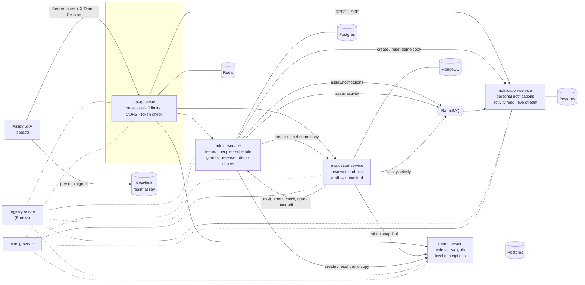

# Assay architecture

Assay grades final-year projects. Several reviewers score each team against a shared rubric. The scores combine into
team grades and a final grade, and students see their results once the coordinator releases them. The demo gives
every visitor a private copy of the data.

## The grading pipeline

1. A reviewer opens the form (`GET /api/my-evaluations/{team}/{assessment}`). evaluation-service asks admin-service
   whether the reviewer holds that assessment's role on the team. If nothing was saved yet, it builds a blank form
   from rubric-service.
2. Drafts autosave (`PUT`). Each level change is recorded for the audit trail and published to `assay.activity`.
3. On submit, evaluation-service computes the score (Σ level × weight ÷ 4) and freezes the evaluation
   (`SUBMITTING`): autosaves are refused with 409 `evaluation-submitting`, so the levels can't drift from the score.
   It then hands the grade to admin-service (idempotent on the evaluation id) and marks it `SUBMITTED`. If the
   hand-off fails, the evaluation goes back to an editable draft, and a retry is always safe.
4. admin-service stores the grade and, in the same transaction, locks the team row and recomputes the team grade
   (a plain average) and the final grade (15/0/25/30/30, which needs all five assessments). Once a grade is final,
   its reviewer set and grades can't change (409 `assessment-final`). It announces only the state changes, so a
   retried hand-off can't count a grade twice.
5. The announcements go to `assay.notifications` (with the recipients resolved) and `assay.activity`.
   notification-service stores one row per recipient and pushes it live over Server-Sent Events.

## Demo copies

- The browser generates a random demo session id and sends it as `X-Demo-Session` on every call.
- Every row and document in the four services carries that id:
  - In the Postgres services, Hibernate's `@TenantId` filters and stamps it automatically.
  - In MongoDB, every query names it.
- `PUT /api/demo/session` asks each service to build its part of the copy from its `demo/seed.json`.
- Seed times are relative ("110 days before the anchor at 23:59"), so "today" is always the middle defense day.
- "Reset my demo" replaces the copy. Every copy is deleted at midnight (Europe/Paris).

The seed is generated by [`seed/generate.py`](../seed/README.md). It checks that the seeded grades reproduce the
design's numbers through the real grade maths.

## Security

- Keycloak issues the tokens. Roles are in `realm_access.roles`: `ADMIN`, `REVIEWER` and `STUDENT`. Jury and
  advisor are per-team roles stored in admin-service.
- The gateway rejects unauthenticated `/api` calls. It routes neither `/internal/**`, actuator nor the config
  server.
- Each service checks roles again with method security. Identity always comes from the token.
- Actuator is limited to health, info and prometheus everywhere.

## API contract

The SPA and the services share one OpenAPI 3.1 contract (`contract/openapi.yaml` in the workspace). Each service also
publishes its own document, aggregated by the gateway at `/swagger-ui.html`.
